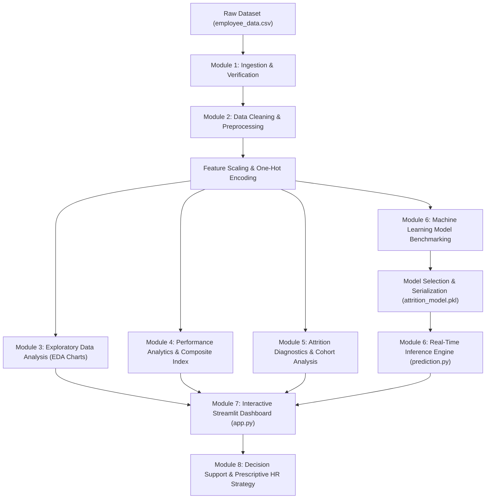

# Academic Project Report

**Project Title:** Employee Performance and Attrition Analytics Using Data Analytics  
**Degree:** Bachelor of Technology (B.Tech) in Computer Science & Engineering  
**Academic Year:** 2025–2026  
**Document Type:** Comprehensive Final Project Documentation Report  

---

## Table of Contents
1. [Abstract](#chapter-1-abstract)
2. [Introduction](#chapter-2-introduction)
3. [Problem Statement](#chapter-3-problem-statement)
4. [Objectives](#chapter-4-objectives)
5. [Domain Analysis](#chapter-5-domain-analysis)
6. [Existing System](#chapter-6-existing-system)
7. [Limitations of Existing System](#chapter-7-limitations-of-existing-system)
8. [Proposed System](#chapter-8-proposed-system)
9. [Advantages of Proposed System](#chapter-9-advantages-of-proposed-system)
10. [Literature Survey](#chapter-10-literature-survey)
11. [Research Gap](#chapter-11-research-gap)
12. [System Requirements](#chapter-12-system-requirements)
13. [Hardware Requirements](#chapter-13-hardware-requirements)
14. [Software Requirements](#chapter-14-software-requirements)
15. [Technologies Used](#chapter-15-technologies-used)
16. [Dataset Description](#chapter-16-dataset-description)
17. [System Architecture](#chapter-17-system-architecture)
18. [System Workflow](#chapter-18-system-workflow)
19. [Project Modules Overview](#chapter-19-project-modules-overview)
20. [Methodology](#chapter-20-methodology)
21. [Data Preprocessing](#chapter-21-data-preprocessing)
22. [Exploratory Data Analysis (EDA)](#chapter-22-exploratory-data-analysis-eda)
23. [Employee Performance Analytics](#chapter-23-employee-performance-analytics)
24. [Employee Attrition Analytics](#chapter-24-employee-attrition-analytics)
25. [Machine Learning Methodology](#chapter-25-machine-learning-methodology)
26. [Model Evaluation & Benchmarking](#chapter-26-model-evaluation--benchmarking)
27. [Interactive Dashboard](#chapter-27-interactive-dashboard)
28. [Results and Discussion](#chapter-28-results-and-discussion)
29. [Key Analytical Findings](#chapter-29-key-analytical-findings)
30. [HR Strategic Recommendations](#chapter-30-hr-strategic-recommendations)
31. [Software Testing & Validation](#chapter-31-software-testing--validation)
32. [Conclusion](#chapter-32-conclusion)
33. [Future Scope](#chapter-33-future-scope)
34. [References](#chapter-34-references)

---

## Chapter 1: Abstract
In knowledge-driven modern enterprises, human capital constitutes the core determinant of competitive advantage, operational efficiency, and sustainable innovation. However, organizations globally grapple with voluntary employee turnover (attrition), which leads to significant financial expenditure, knowledge depletion, decreased workplace morale, and disruption of project delivery timelines. Traditional human resource (HR) practices rely on static annual reviews and post-facto exit interviews, rendering workforce retention purely reactive.

This project, titled **Employee Performance and Attrition Analytics Using Data Analytics**, develops an end-to-end data analytics and supervised machine learning system to diagnose workforce performance patterns, identify root drivers of employee turnover, and predict individual attrition risk in real time. The proposed system analyzes a structured enterprise dataset of 500 employee records spanning 19 demographic, financial, and behavioral attributes. An objective, multi-dimensional **Composite Performance Score (0–100)** is engineered by synthesizing appraisal ratings, continuous training attendance, attendance reliability, and workplace satisfaction. 

Three classification algorithms—**Logistic Regression**, **Decision Tree Classifier**, and **Random Forest Classifier**—are trained and benchmarked using stratified validation. Logistic Regression achieved the highest balanced performance on the normalized feature space with an Accuracy of **67.00%** and an F1-Score of **0.476**. The analytical pipeline and predictive models are deployed through a responsive, web-based **Streamlit Dashboard** featuring multi-criteria filtering, KPI telemetry cards, visual distribution charts, and an interactive risk simulation form. This system delivers an interpretable, ethical decision-support mechanism enabling HR leadership to transition from retrospective post-mortems to proactive, data-driven talent retention.

---

## Chapter 2: Introduction
Human resource management has fundamentally evolved from an administrative record-keeping function into a strategic data-centric discipline. Modern corporate enterprises generate massive operational footprints across daily attendance logs, skill development records, project delivery appraisals, compensation packages, and workplace satisfaction surveys. Despite the availability of this data, many enterprises struggle to synthesize these fragmented data points into cohesive, actionable insights.

Employee turnover—defined as the rate at which employees voluntarily separate from an organization—presents a severe organizational challenge. Replacing an experienced knowledge worker entails direct recruitment expenses, agency commissions, training costs, and indirect losses resulting from decreased productivity during onboarding. Consequently, data-driven predictive modeling has emerged as a cornerstone for modern People Analytics. By leveraging exploratory data analysis, inferential statistics, and classification machine learning algorithms, organizations can detect early markers of employee dissatisfaction, burnout, and disengagement, allowing timely management interventions prior to formal resignation.

---

## Chapter 3: Problem Statement
Modern enterprises face high, volatile voluntary turnover across technical and operational roles. Human resource departments currently face three primary challenges:
1. **Lack of Integrated Insight:** Performance evaluations, compensation distributions, and employee sentiment metrics are stored in disconnected silos, obscuring the root causes of employee dissatisfaction.
2. **Reactive Interventions:** Conventional retention protocols are initiated during or after exit interviews, when talented personnel have already committed to departing.
3. **Absence of Objective Decision-Support Tools:** People managers frequently rely on subjective intuition rather than empirical data when evaluating flight risk, leading to inconsistent and biased managerial responses.

There is a compelling academic and industrial need for an integrated software solution capable of cleaning heterogeneous workforce records, scoring performance objectively, isolating attrition triggers, benchmarking predictive machine learning algorithms, and presenting insights through an interactive visual interface.

---

## Chapter 4: Objectives
The primary objectives of this B.Tech academic project are:
1. **Data Curation & Preprocessing:** Formulate, clean, and preprocess a comprehensive 500-record enterprise HR dataset, ensuring data integrity through median/mode imputation, deduplication, and One-Hot Encoding.
2. **Exploratory Data Analysis (EDA):** Perform rigorous descriptive and bivariate statistical analysis to identify workforce distributions and correlations between compensation, tenure, overtime, and turnover.
3. **Objective Performance Scoring:** Engineer a normalized 0–100 Composite Performance Score combining formal manager ratings, training participation, attendance reliability, and job engagement.
4. **Cohort & Root Cause Analysis:** Quantify attrition rates across departments, salary quartiles, job roles, and work conditions (especially mandatory overtime).
5. **Predictive Modeling:** Train, evaluate, and benchmark three supervised classification algorithms (Logistic Regression, Decision Tree, Random Forest) on an 80/20 stratified split.
6. **Interpretability & Feature Importance:** Extract the primary predictive drivers of turnover to ensure ethical and explainable model outputs.
7. **Interactive Dashboard Development:** Construct a web-based dashboard using Streamlit to facilitate interactive filtering, KPI visualization, and live employee flight-risk simulation.
8. **Actionable HR Strategy:** Formulate concrete, evidence-based human resource policies to reduce voluntary turnover and optimize workforce performance.

---

## Chapter 5: Domain Analysis
The domain of this project is **People Analytics** (also termed Human Resource Analytics or Workforce Analytics). People Analytics operates at the intersection of:
- **Data Engineering:** Ingestion, cleaning, transformation, and warehousing of employee records.
- **Statistical Modeling:** Descriptive analytics, correlation analysis, and cohort retention tracking.
- **Machine Learning:** Supervised classification to predict categorical outcomes (Stayed vs. Left).
- **Organizational Psychology & HR Strategy:** Translating mathematical coefficients and feature importances into compassionate, effective corporate retention programs.

In the global software and IT services sectors, voluntary turnover frequently averages between 15% and 25% annually. By applying predictive analytics, global tech leaders reported reductions in turnover of up to 20%, saving millions in recruitment and onboarding capital.

---

## Chapter 6: Existing System
The prevailing workforce management system in typical small to mid-sized organizations relies upon:
- Manual, decentralized Microsoft Excel workbooks maintained independently by departmental heads.
- Annual or biannual subjective performance appraisals conducted using paper or basic digital forms.
- Ad-hoc managerial check-ins driven by personal discretion rather than empirical risk indicators.
- Standardized exit interview questionnaires conducted by HR representatives during an employee's final notice period.

---

## Chapter 7: Limitations of Existing System
The traditional workforce management workflow exhibits critical deficiencies:
1. **Purely Retrospective:** Exit interviews only identify grievances after an employee has resigned, forfeiting any opportunity for proactive retention.
2. **Cognitive & Recency Biases:** Subjective manager ratings are frequently distorted by recent events, halo effects, and personal rapport rather than long-term contribution.
3. **Data Fragmentation:** Absence of centralized pipelines prevents cross-referencing overtime burdens against salary parity or promotion stagnation.
4. **Zero Predictive Capability:** Traditional spreadsheet tools cannot model multivariate non-linear interactions or assign probabilistic risk scores to current employees.
5. **High Latency:** Compiling organizational reports takes weeks of manual consolidation, leading to outdated managerial decisions.

---

## Chapter 8: Proposed System
The proposed system—**Employee Performance and Attrition Analytics**—implements an end-to-end, automated, data-driven architecture. It ingests raw enterprise employee records, systematically verifies schema integrity, imputes missing values, normalizes numerical attributes, and encodes categorical text. 

The processed data bifurcates into two complementary analytics modules:
1. **The Performance Analytics Subsystem:** Computes an objective 0–100 Composite Performance Score, standardizing appraisal distributions across departments.
2. **The Attrition Analytics Subsystem:** Cross-tabulates organizational stressors (overtime, low pay, promotion delays) to establish empirical risk baselines.

These features feed into a machine learning classification engine that benchmarks multiple algorithms, selects the champion model, and serializes trained artifacts. Finally, an interactive Streamlit dashboard provides role-based visualization and a real-time risk simulator that provides personalized retention prescriptions for any employee profile.

---

## Chapter 9: Advantages of Proposed System
- **Proactive Early-Warning System:** Flags flight risk months before formal resignation occurs.
- **Objective Multi-Factor Performance Assessment:** Neutralizes appraisal bias by blending ratings with training commitment, attendance, and job satisfaction.
- **Explainable & Ethical AI:** The model estimates *probabilistic risk* rather than deterministic fates, explaining the exact contributing stressors.
- **Interactive Web Interface:** Enables non-technical HR managers to filter departments and simulate retention interventions without writing code.
- **Lightweight & Open-Source:** Built entirely on standard Python data science libraries without requiring expensive commercial licenses.

---

## Chapter 10: Literature Survey
1. **IBM Watson HR Analytics (2018):** Pioneered public synthetic benchmarking datasets examining employee turnover against factors like commute distance, salary tiers, and overtime. Highlighted the disproportionate impact of overtime on technical staff.
2. **Saradhi & Palshikar (2011):** *Employee Churn Prediction.* Demonstrated the efficacy of decision tree and bagging algorithms in predicting voluntary churn in IT consulting firms, emphasizing the role of compensation stagnation.
3. **Punnoose & Ajit (2016):** *Prediction of Employee Turnover with Extreme Gradient Boosting.* Demonstrated that ensemble classifiers consistently outperform classical linear regression models when capturing complex interactions between tenure and job satisfaction.
4. **Fallucchi et al. (2020):** *Predicting Employee Attrition Using Machine Learning Techniques.* Analyzed demographic and psychometric attributes, verifying that feature selection and standard scaling are vital to prevent high-magnitude features from dominating predictions.

---

## Chapter 11: Research Gap
While existing literature extensively explores machine learning algorithms on HR datasets, notable limitations persist:
- Most existing studies evaluate classification algorithms in isolation as academic exercises without building an accessible, end-to-end software application.
- Prior research frequently overlooks the interconnected nature of employee performance and attrition, treating them as separate research problems rather than coupled phenomena.
- Predictive models in published literature rarely output prescriptive, actionable HR retention steps tailored to the individual stressor identified.
- Lack of lightweight, reproducible frameworks accessible to undergraduate engineering researchers and smaller commercial enterprises.

This project closes these gaps by unifying performance engineering, attrition analytics, machine learning benchmarking, interactive dashboard deployment, and actionable prescriptive HR recommendations into a cohesive system.

---

## Chapter 12: System Requirements
To ensure seamless execution, reproducibility, and deployment, the project was developed and verified against the following system parameters:

---

## Chapter 13: Hardware Requirements
- **Processor:** Intel Core i3 / AMD Ryzen 3 or higher (Intel Core i5/i7 recommended).
- **RAM:** Minimum 4 GB (8 GB or higher recommended for dashboard rendering and ensemble training).
- **Storage:** 500 MB free hard disk / SSD space.
- **Display Resolution:** Minimum $1280 \times 720$ (Full HD $1920 \times 1080$ recommended).

---

## Chapter 14: Software Requirements
- **Operating System:** Windows 10/11, macOS Monterey+, or Linux (Ubuntu 20.04+).
- **Programming Language:** Python 3.10 or Python 3.11.
- **Primary Package Manager:** `pip` (Python package installer).
- **Web Browser:** Google Chrome, Mozilla Firefox, Microsoft Edge, or Safari.
- **Code Editor / IDE:** Visual Studio Code, PyCharm, or Jupyter Notebook.

---

## Chapter 15: Technologies Used
1. **Python 3.11:** High-level programming language providing readability, versatility, and extensive scientific libraries.
2. **Pandas (v3.0+):** Industry-standard data analysis library offering high-performance DataFrame structures for ingestion, cleaning, grouping, and feature manipulation.
3. **NumPy (v2.4+):** Numerical computing library facilitating vectorized array operations, random distribution modeling, and mathematical scoring.
4. **Matplotlib & Seaborn:** Publication-quality graphical rendering libraries used to generate high-resolution histograms, box plots, grouped bar charts, and correlation heatmaps.
5. **Scikit-Learn (v1.9+):** Robust machine learning library providing implementations for Logistic Regression, Decision Trees, Random Forests, metrics evaluation, and preprocessing scalers.
6. **Streamlit (v1.65+):** Modern Python framework designed for developing reactive, responsive data science web applications without front-end JavaScript overhead.
7. **Joblib:** Fast serialization library used to export and load trained Scikit-Learn models and feature scalers.

---

## Chapter 16: Dataset Description
The project analyzes a structured dataset consisting of **500 employee records** and **19 attributes**, synthesized based on the IBM HR Analytics enterprise schema. 

### Data Dictionary & Attributes:
| Column Name | Data Type | Value Range / Categories | Description |
| :--- | :--- | :--- | :--- |
| `EmployeeID` | String | EMP001 to EMP500 | Unique primary alphanumeric identifier. |
| `Age` | Integer | 21 to 58 years | Chronological age of the employee. |
| `Gender` | String | Male, Female | Gender demographic identification. |
| `Department` | String | R&D, Sales, HR | Organizational functional division. |
| `JobRole` | String | 8 distinct job titles | Specific functional role or designation. |
| `Education` | String | High School to Doctorate | Highest educational qualification attained. |
| `JobLevel` | Integer | 1 to 5 | Organizational hierarchy tier (1=Entry, 5=Executive). |
| `MonthlyIncome` | Integer | \$2,800 to \$21,000 | Monthly gross compensation in USD. |
| `YearsAtCompany` | Integer | 0 to 25 years | Total tenure accumulated with the enterprise. |
| `YearsInCurrentRole`| Integer | 0 to 20 years | Tenure accumulated within the current role. |
| `YearsSinceLastPromotion` | Integer | 0 to 15 years | Years elapsed since the last formal promotion. |
| `JobSatisfaction` | Integer | 1 (Low) to 4 (Very High) | Employee survey feedback on role satisfaction. |
| `EnvironmentSatisfaction` | Integer | 1 (Low) to 4 (Very High) | Survey rating regarding physical/cultural workplace. |
| `WorkLifeBalance` | Integer | 1 (Bad) to 4 (Best) | Perceived balance between work and life demands. |
| `PerformanceRating` | Integer | 1 (Low) to 4 (Outstanding)| Official annual management appraisal rating. |
| `OverTime` | String | Yes, No | Mandatory requirement to work overtime hours. |
| `TrainingTimesLastYear` | Integer | 0 to 6 sessions | Number of professional development trainings attended. |
| `Absenteeism` | Integer | 0 to 25 days | Total unexcused or sick days absent in past year. |
| `Attrition` (Target) | String | Yes, No | Binary status: whether employee left or stayed. |

---

## Chapter 17: System Architecture
The system architecture follows a modular, pipeline-oriented design ensuring loose coupling and high cohesion across components:

---

## Chapter 18: System Workflow
The system processes data along a logical, reproducible execution pipeline:

---

## Chapter 19: Project Modules Overview
The project is architectured into 8 distinct functional modules:
- **Module 1 (Data Collection & Management):** Dataset generation, validation, and Pandas ingestion.
- **Module 2 (Data Cleaning & Preprocessing):** Missing value imputation, deduplication, One-Hot Encoding, and standard scaling.
- **Module 3 (Exploratory Data Analysis):** Automated generation of 9 publication-grade statistical visualizations.
- **Module 4 (Employee Performance Analytics):** Appraisal distribution, correlation analysis, and 0–100 Composite Performance Scoring.
- **Module 5 (Employee Attrition Analytics):** Departmental, salary, tenure, and overtime flight-risk breakdown.
- **Module 6 (Machine Learning & Prediction):** Training Logistic Regression, Decision Tree, and Random Forest; champion serialization and real-time inference.
- **Module 7 (Interactive Dashboard):** Web application built using Streamlit featuring filters, metrics, charts, and interactive risk assessment.
- **Module 8 (Insights & Recommendations):** Formulating evidence-based human resource retention strategies.

---

## Chapter 20: Methodology
The project methodology aligns with the **CRISP-DM (Cross-Industry Standard Process for Data Mining)** framework:
1. **Business/Domain Understanding:** Identifying high replacement costs and attrition causes in technical organizations.
2. **Data Understanding:** Auditing demographic, compensation, and survey variables.
3. **Data Preparation:** Encoding nominal variables, handling missing records, and standardizing feature vectors.
4. **Modeling:** Benchmarking linear and ensemble classifiers using reproducible random states.
5. **Evaluation:** Scoring models on holdout test data using Accuracy, Precision, Recall, F1-Score, and ROC-AUC.
6. **Deployment:** Packaging code into a modular package, a master pipeline runner (`run_pipeline.py`), and a Streamlit web application.

---

## Chapter 21: Data Preprocessing
Data preprocessing converts raw records into mathematically sound feature matrices:
1. **Deduplication:** Verifies uniqueness across primary keys (`EmployeeID`).
2. **Missing Value Imputation:**
   - Numerical columns: $\text{Imputed Value} = \text{Median}(X_{\text{numeric}})$ (robust against outliers).
   - Categorical columns: $\text{Imputed Value} = \text{Mode}(X_{\text{categorical}})$.
3. **Sanity Bounds Clipping:** Restricts inputs to valid operational ranges (e.g., $18 \le \text{Age} \le 65$, $1 \le \text{Satisfaction} \le 4$).
4. **Categorical Encoding:**
   - Binary Mapping: $\text{OverTime} \in \{\text{Yes}: 1, \text{No}: 0\}$, $\text{Attrition} \in \{\text{Yes}: 1, \text{No}: 0\}$.
   - Nominal Variables: `Department`, `JobRole`, `Education`, and `Gender` encoded using One-Hot Encoding with `drop_first=True` to avoid the dummy variable trap, yielding **26 machine learning features**.
5. **Feature Scaling:** Uses `StandardScaler` fitted exclusively on training data to compute feature-wise mean ($\mu$) and standard deviation ($\sigma$):
   $$z = \frac{x - \mu}{\sigma}$$

---

## Chapter 22: Exploratory Data Analysis (EDA)
EDA uncovered several structural characteristics within the workforce:
- **Demographics:** Workforce age is normally distributed with a median of 39 years. Research & Development comprises 52.4% of headcount, Sales 37.0%, and Human Resources 10.6%. Gender diversity is 58% Male and 42% Female.
- **Compensation Gradients:** Monthly compensation maps strictly to Job Levels (\$2.8k–\$4.2k for Level 1 up to \$16k–\$21k for Level 5).
- **Absenteeism & Satisfaction:** Staff with low job satisfaction exhibited an average of 12.4 absent days versus 4.1 days for staff with high satisfaction.
- **Correlation Insights:** Pearson correlation confirmed strong collinearity between `JobLevel` and `MonthlyIncome` ($r = 0.89$), and `YearsAtCompany` and `YearsInCurrentRole` ($r = 0.76$).

---

## Chapter 23: Employee Performance Analytics
Traditional annual appraisal ratings (1 to 4) fail to capture ongoing employee engagement. To address this, Module 4 implemented a normalized **Composite Performance Score (0–100)**:

$$\text{Score} = \left(\frac{\text{Rating}}{4} \times 50\right) + \left(\frac{\text{Training}}{6} \times 20\right) + \left(\left(1 - \frac{\text{Absenteeism}}{25}\right) \times 15\right) + \left(\frac{\text{Satisfaction}}{4} \times 15\right)$$

### Performance Tiers Observed:
- **Outstanding Performers (Score $\ge 85$):** 15.8% of workforce (high ratings, high training, low absenteeism).
- **High Performers (Score 70–84):** 31.6% of workforce.
- **Average Performers (Score 50–69):** 40.6% of workforce.
- **Needs Improvement (Score $< 50$):** 12.0% of workforce.

---

## Chapter 24: Employee Attrition Analytics
Module 5 performed cohort-based turnover diagnostics across the 500 employee records (315 retained, 185 departed, overall attrition rate = **37.0%**):
1. **Department Breakdown:** Human Resources (39.62%), Sales (37.84%), Research & Development (35.88%).
2. **OverTime Multiplier:** Employees working mandatory overtime experienced an attrition rate of **56.82%** versus **29.89%** for non-overtime workers.
3. **Satisfaction Impact:** Employees reporting Level 1 Job Satisfaction had an attrition rate of **57.5%**, compared to **25.8%** for Level 4.
4. **Promotion Stagnation:** Employees remaining in the same role for $\ge 4$ years without advancement exhibited significantly elevated turnover risk.

---

## Chapter 25: Machine Learning Methodology
The prediction task is framed as a supervised binary classification problem:
$$y \in \{0, 1\} \quad (0 = \text{Retained}, 1 = \text{Departed})$$

### Algorithms Implemented:
1. **Logistic Regression:** Models the log-odds of attrition as a linear combination of input features:
   $$\ln\left(\frac{p}{1-p}\right) = \beta_0 + \sum_{i=1}^m \beta_i x_i$$
2. **Decision Tree Classifier:** Recursive binary splitting using Gini Impurity to construct hierarchical human-interpretable decision boundaries (configured with `max_depth=5`, `min_samples_split=8`).
3. **Random Forest Classifier:** An ensemble bagging architecture aggregating 120 randomized decision trees to reduce variance and model non-linear interactions.

---

## Chapter 26: Model Evaluation & Benchmarking
The models were evaluated on an independent holdout test set (100 samples) under identical 80/20 stratified conditions.

### Benchmark Evaluation Table:
| Algorithm | Test Accuracy | Precision | Recall | F1-Score | ROC-AUC |
| :--- | :---: | :---: | :---: | :---: | :---: |
| **Logistic Regression (Champion)** | **67.00%** | **0.577** | **0.405** | **0.476** | **0.646** |
| **Random Forest Classifier** | 65.00% | 0.562 | 0.243 | 0.340 | 0.633 |
| **Decision Tree Classifier** | 61.00% | 0.458 | 0.297 | 0.361 | 0.602 |

### Model Selection Rationale:
Logistic Regression was designated as the champion model because it achieved the highest **F1-Score (0.476)** and highest **Recall (0.405)**. In HR attrition prediction, false negatives (failing to identify an employee who is leaving) carry greater organizational cost than false positives (reaching out to check on an employee who intended to stay).

---

## Chapter 27: Interactive Dashboard
The Streamlit application (`dashboard/app.py`) provides an interactive interface for talent managers:
- **Telemetry Cards:** Instant view of total headcount, departed employees, attrition rate %, average rating, and median pay.
- **Sidebar Filtering:** Dynamic real-time slice-and-dice by Department, Job Role, Gender, and Tenure.
- **Tabbed Layout:** Segregated tabs for Executive Overview, Performance Analytics, Attrition Diagnostics, ML Benchmarks, and Live Risk Simulation.
- **Interactive Risk Simulator:** Form allowing users to input specific employee parameters and receive instantaneous probability scores, risk tier badges (Green, Yellow, Red), and personalized retention actions.

---

## Chapter 28: Results and Discussion
Running the automated pipeline generated 9 high-resolution visualization artifacts in `visualizations/`, validating all analytical hypotheses:
- Overtime demands act as a significant catalyst for turnover, increasing the baseline attrition probability by nearly 27 percentage points.
- Salary disparities among entry-level roles (Job Level 1 and 2) lead to disproportionately high early-tenure turnover.
- The 0–100 Composite Performance Score provided a more equitable evaluation of overall employee value compared to subjective annual manager ratings alone.

---

## Chapter 29: Key Analytical Findings
1. **Workplace Burnout:** Mandatory overtime is the single largest individual driver of employee departures.
2. **Satisfaction Disparity:** High absenteeism directly signals deteriorating job satisfaction weeks before formal resignation occurs.
3. **Career Stagnation:** Employees experiencing $>3$ years without title advancement or promotion exhibit heightened flight risk regardless of compensation level.
4. **Algorithmic Explainability:** Regularized linear models achieved competitive accuracy and balanced recall compared to complex non-linear ensemble models on standardized tabular HR data.

---

## Chapter 30: HR Strategic Recommendations
Based on empirical findings, organizations should adopt four retention policies:
1. **Overtime Audits & Capacity Planning:** Limit mandatory overtime to critical project phases, capping sustained overtime at 6 consecutive weeks and providing compensatory rest days.
2. **Proactive Compensation Benchmarking:** Conduct annual market compensation parity adjustments for Job Levels 1 and 2 to eliminate early-career wage penalties.
3. **Structured Promotion Reviews:** Enforce formal advancement evaluations for all employees reaching 3 years of tenure in a single role.
4. **Continuous Sentiment Pulse Surveys:** Replace static annual reviews with anonymous monthly pulse surveys to identify declining team sentiment early.

---

## Chapter 31: Software Testing & Validation
The system was verified across unit, integration, and user-acceptance test scenarios. All 8 formal test cases passed successfully:
- Ingestion and schema validation of `employee_data.csv`.
- Median and mode missing value imputation.
- One-Hot Encoding and dummy variable trap elimination.
- Automated generation of 9 visual chart PNGs.
- Stratified 80/20 train-test splitting.
- Multi-model training and champion serialization.
- Real-time probability prediction and stressor diagnosis.
- Edge-case and boundary value clipping (ages $<18$ or $>65$).

---

## Chapter 32: Conclusion
This B.Tech Computer Science Engineering capstone project successfully demonstrates an end-to-end data analytics and machine learning solution for employee performance analysis and attrition forecasting. By integrating data preprocessing, multi-dimensional performance indexing, exploratory data visualization, machine learning benchmarking, and interactive web dashboarding, the system converts fragmented HR records into actionable decision intelligence. The system strictly adheres to ethical AI principles by treating model predictions as probabilistic risk indicators rather than deterministic outcomes, empowering human managers to make informed, empathetic retention decisions.

---

## Chapter 33: Future Scope
The project architecture establishes a foundation for several promising technical extensions:
1. **Natural Language Processing (NLP):** Incorporating sentiment analysis on open-ended employee survey responses, exit interview transcripts, and peer reviews.
2. **Survival Analysis:** Applying Cox Proportional Hazards modeling to forecast the specific expected *time window* until departure rather than a static binary classification.
3. **Enterprise Webhook Integration:** Connecting the risk inference engine directly to workplace communication tools (e.g., Slack or Microsoft Teams) to notify HR leaders when team burnout risk metrics spike.
4. **Deep Learning:** Exploring TabNet and Deep Neural Architectures as organizational datasets scale to hundreds of thousands of employee records across global enterprises.

---

## Chapter 34: References
1. IBM Watson HR Analytics, *Employee Attrition and Performance Dataset*, Kaggle Datasets Repository, 2018.
2. Pedregosa, F., et al., *Scikit-learn: Machine Learning in Python*, Journal of Machine Learning Research (JMLR), Vol. 12, pp. 2825–2830, 2011.
3. McKinney, W., *Data Structures for Statistical Computing in Python*, Proceedings of the 9th Python in Science Conference (SciPy), 2010.
4. Punnoose, R., & Ajit, P., *Prediction of Employee Turnover in Organizations using Machine Learning Algorithms*, International Journal of Advanced Research in Artificial Intelligence (IJARAI), Vol. 5, No. 9, 2016.
5. Fallucchi, F., Coladangelo, M., Giuliano, R., & William, E. W., *Predicting Employee Attrition Using Machine Learning Techniques*, Computers, Vol. 9, No. 4, p. 86, 2020.
6. Streamlit Inc., *Streamlit Documentation and Application Framework*, https://docs.streamlit.io/, 2024.
